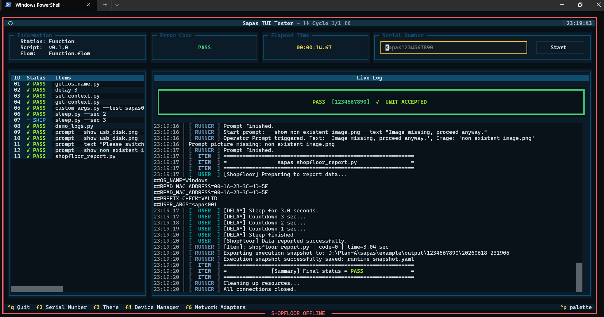

⚠️ **Active Development Notice** This project is under active development. APIs and internal structures may evolve as we continuous align cross-team requirements.

# Sapas
[](https://opensource.org/licenses/MIT)


> **Sapas** /sa'paʃ/ — Inspired by the phrase for *"Bravo! Well done!"* Our goal is simple: automate your hardware tests seamlessly from early-stage bring-up to high-throughput production.

A unified hardware test automation platform for the entire product lifecycle — bridging the gap between RD verification, CI/CD Hardware-in-the-Loop (HIL) testing, factory production, and RMA diagnostics.

---

### 🎉 100% Free & Open Source 
**sapas** is completely free and open-source under the MIT license! You can freely clone it, modify it, and use it in your personal projects or commercial factory production lines without any cost.



## The Problem It Solves: The Lifecycle Fragmentation

In the lifecycle of hardware product development, testing is often fragmented across different teams and phases:

1. **RD (Research & Development)** writes custom validation scripts in the lab to bring up the hardware and run sweeps.
2. **QA/TE (Quality Assurance & Test Engineering)** re-writes validation test benches for regression and reliability testing.
3. **PE (Production/Manufacturing)** struggles to deploy a frankenstein framework on the shop floor, leading to untraceable bugs and heavy maintenance.
4. **RMA (Return Merchandise Authorization)** uses different ad-hoc tools to diagnose returned devices.

**Sapas** is built to break these silos. It is NOT just another "high-performance" runner; it is a **unified hardware testing platform** designed to be the single source of truth from early engineering labs to continuous assembly lines and service centers.

---

## 🎯 Target Scenarios: Beyond the Factory Floor

Sapas's decoupled architecture makes it versatile across multiple stages of hardware development:

* **🔬 RD Lab & Characterization**: Sweep testing, calibration, and characterization (e.g., PVT testing) without writing boilerplate logging or reporting logic.
* **🤖 CI/CD & HIL (Hardware-in-the-Loop)**: Run daily smoke tests or firmware regression validation on physical test benches automatically on every code commit.
* **🏭 Factory Production Lines**: Station looping, operator-friendly TUI, barcode serial number bindings, and secure data convergence for shopfloor databases.
* **🔧 RMA & Field Service Diagnostics**: A lightweight, terminal-based TUI tool for repair centers to run step-by-step guided hardware diagnostics on technicians' laptops.

---

## Core Philosophy: Unified Architecture

Sapas provides a clean abstraction layer that allows RD, TE, and Factory operators to speak the exact same language:

* **For RD (Lab Verification)**: It acts as a structured environment to write modular `TestItem` blocks using standard protocols (SSH, ADB, UART) without worrying about factory databases or UI rendering.
* **For TE (Deployment & Criteria)**: It separates test logic from standard criteria. TE can shift test limits or sequencing via dynamic configuration files (YAML/CSV) without touching the core code written by RD.
* **For Factory Control & Automation**: It wraps everything into a robust, operator-friendly CLI/TUI environment. It handles continuous looping, serial number inputs, and data hygiene automatically.

---

## Why Sapas?

* **Bridge the Gap**: Stop re-writing scripts. The exact same Python code written during early validation can be directly deployed onto the production line or used in automated regression testing.
* **Separation of Concerns**:
  * **RD** controls the **Logic** (How to interact with the device).
  * **TE** controls the **Criteria & Sequence** (What defines a PASS/FAIL and in what order).
  * **Sapas Engine** controls the **Infrastructure** (Logs, UI, data convergence, and hardware connection pools).
* **Defensive by Design**: Implements strict data normalization (e.g., rigid boolean convergence) and contract checking (`opas.var.require`) to prevent laboratory scripts from breaking under harsh factory environments.
* **Industrial Safety & Remote Interlock**: Built-in **Station Guard** system bridges remote R&D SSH maintenance and on-site factory floor safety. It enforces physical safety interlocks on station displays, eliminates accidental MES contamination, and provides emergency brakes.
* **Standalone HTML Diagnostic Reports**: Every test cycle automatically generates a 100% offline, single-file HTML report (`{SN}_{Timestamp}_{PASS|FAIL|STOP}.html`) bundling Fixture ID, Retest counter, collapsible per-script (`[+] script.py`) measurement tables (with auto-expand on failure and per-script execution times), and embedded raw console logs — allowing operators to send a single lightweight file for instant remote triage.
* **Local SQLite Station Database & Interactive Yield Dashboard (`sapas summary`)**: Every test cycle is recorded in `< 2ms` (SQLite `WAL` mode) into `output/sapas_local_{STATION}_{FIXTURE_ID}.db` with indexed summary columns plus a complete JSON measurement snapshot. Running `sapas summary` (or `sapas summary <path/to/file.db>`) generates a 100% offline interactive SPA dashboard (`station_summary_{STATION}_{FIXTURE_ID}.html`) featuring in-browser date/status/search filtering, real-time FPY & overall yield recalculation, Top Failures Pareto breakdown, hourly/daily throughput trends, and an embedded **Database Snapshot Modal** so engineers can inspect full measurement tables even after raw station folders are archived to FTP/NAS.
* **Aesthetic & Noise-Free CLI**: A unified terminal output powered by `rich`, using balanced visual markers (`✓` / `❌`) ensuring that field technicians or developers can instantly read station health without parsing through raw text noise.

---

## 🌐 Documentation / 說明文件

Explore the full guides in your preferred language:

* 🇺🇸 **[English Documentation](./docs/en/README.md)**
  * [Quick Start](./docs/en/01_quick_start.md) | [Architecture](./docs/en/02_architecture.md) | [Station Loop Mode](./docs/en/07_how_to_build_a_station.md) | [Station Guard & Remote Maintenance](./docs/en/10_station_guard_guide.md)
* 🇹🇼 **[繁體中文說明文件](./docs/zh/README.md)**
  * [快速開始](./docs/zh/01_quick_start.md) | [架構設計](./docs/zh/02_architecture.md) | [生產線站點部署](./docs/zh/07_how_to_build_a_station.md) | [現場防護與遠端維護手冊](./docs/zh/10_station_guard_guide.md)

---

## Core Concepts

* **Sequence-Driven Framework**: Test paths are decoupled from implementation. Sequences are orchestrated via configuration files, allowing rapid updates on the shop floor.
* **Unified Result Manager & HTML Reporter**: Eliminates fragmentation in telemetry. Every single test module feeds into a standardized data model and self-contained HTML diagnostic report, ensuring tracking stability across all shifts.
* **Multi-Protocol Link Layer**: Built-in support for standard engineering interfaces (**ADB**, **UART**, and **SSH**) so teams don't reinvent connection wrappers.
* **Active Station Interlock**: Coordinated physical desktop guard and runtime engine preventing cross-continent collisions between remote R&D maintenance and on-site line operators.

---

## 🛡️ Station Guard: Active Industrial Safety & Remote Interlock

In modern manufacturing, remote R&D and test engineers frequently connect via SSH to on-site or overseas station fixtures for calibration and diagnostics. This introduces severe physical hazards (operators touching moving parts unaware) and data risks (accidental injection of debug test records into production MES).

**Sapas Station Guard** provides an out-of-the-box, cross-session safety interlock system:

* 🚨 **Physical Desktop Interlock**: Pops up a topmost, fullscreen red warning window and traps mouse/keyboard focus on the physical station monitor during remote sessions.
* 🛡️ **Zero MES Contamination**: Remote test runs automatically override `ENABLE_SHOPFLOOR=False`, ensuring debug data never pollutes official factory databases.
* 🛑 **Emergency Brake**: If an on-site supervisor enters an authorized override sequence on the physical keyboard, all active remote test runners are immediately halted.
* ⚡ **Zero-Touch Commissioning**: Built-in Windows Task Scheduler registration (`sapas guard install`) effortlessly handles Windows Session 0 isolation without manual service configuration.

```bash
# Station PC commissioning (Run once as Administrator)
sapas guard install

# Remote maintenance from engineer's laptop
sapas guard lock -m "RD remote diagnosing camera sensor"
sapas run_sensor_check.py
sapas guard unlock
```

> 📖 For full architecture, OpenSSH configuration, and on-site override SOPs, see the [Station Guard & Remote Maintenance Guide](./docs/en/10_station_guard_guide.md) (繁中: [現場防護與遠端維護手冊](./docs/zh/10_station_guard_guide.md)).

---

## Installation & Getting Started

To install or update Sapas in editable mode for cross-team development (this automatically updates dependencies such as `textual`):

```bash
# 1. Clone the repository and install Sapas
git clone https://github.com/kumamodo/sapas.git
cd sapas
pip install -e .

# 2. Go to the example project folder (CRITICAL!)
cd example/

# 3. Run the automation platform (Choose one mode below)
# Mode A: Standard CLI Mode
sapas --project Alishan --station Function

# Mode B: Interactive TUI Dashboard (Recommended for Stations)
sapas --project Alishan --station Function --tui
```

## Factory/Station Deployment (Recommended)

Alternatively, to avoid typing long arguments, you can pre-define your target environment inside `site_infra.yaml`:

```yaml
# site_infra.yaml (Example for Alishan)
PROJECT_NAME: Alishan
STATION_NAME: Function
```

Once this file is set up, simply navigate to that project directory (`example/`) and execute the bare command:

```bash
sapas
# or for TUI dashboard
sapas --tui
```

## Advanced Development & Debugging

Single-Step Script Execution (Isolated Testing)

During development or factory-line debugging, you do not need to run the entire station testing loop just to verify a single modification. \*\*Sapas\*\* allows you to execute any individual \`TestItem\` or \`ActionItem\` script independently right from your project root directory.  Simply open your terminal at the project root and pass the filename directly to the \`sapas\` CLI:

```bash
sapas get_os_name.py
```

### Station Yield & Quality Summary Dashboard (`sapas summary`)

Generate and open a self-contained, interactive HTML yield and failure analytics dashboard directly from the station's local SQLite database (`output/sapas_local_{STATION}_{FIXTURE_ID}.db`) or any `.db` file downloaded from a production line:

```bash
# Auto-detect the latest local database in output/ and open the dashboard
sapas summary

# Or pass a specific .db file path directly (e.g., downloaded from a station PC)
sapas summary ~/Downloads/sapas_local_FAN_44205100.db
```

