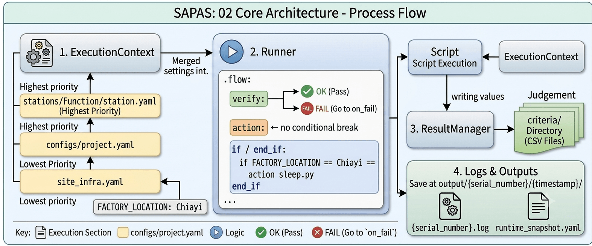

# 02 Core Architecture

The architectural design of Sapas aims to decouple "test logic", "environment configuration", and "connection drivers". We use the `Function` station in `example/Alishan` as an example for explanation.



## 1. ExecutionContext

`ExecutionContext` is the data hub of the entire system. It automatically merges configuration files at startup. The priority is as follows:
`stations/Function/station.yaml` > `configs/project.yaml` > `site_infra.yaml`.

**Example**:
`FACTORY_LOCATION: Chiayi` is defined in `site_infra.yaml`. In `function.flow`, this variable can be used directly for decision-making.

**Variable Access Interface**:
In the future, whether in a **Python Script**, if you want to read or write data, you can achieve it through `sapas.var.get()` and `sapas.var.set()`. It acts as a "global-level" storage space, ensuring data can flow smoothly between different steps.

## 2. Runner

The `Runner` is responsible for parsing `.flow` files. Refer to `example/Alishan/flows/function.flow`:

```yaml
start function
    cycle 1
        verify get_os_name.py                                              # Execute script and verify result
        delay 3                                                            # Built-in delay function
        if FACTORY_LOCATION == Chiayi
            action sleep.py --sec 2                                        # Conditional execution
        else
            action sleep.py --sec 1                                        # Fallback execution
        end_if
        action demo_logs.py                                                # Execute log demonstration script
        prompt --show usb_disk.png --text "Insert USB"                     # Operator prompt
stop

on_fail
    action sleep.py --sec 4                                                # Rollback mechanism on failure
end

final
    action power_off.py                                                    # Guaranteed teardown execution regardless of PASS or FAIL
end
```

### Flow Blocks & Key Commands:

#### Flow Blocks:
- `start ... stop`: Main test sequence block.
- `on_fail ... end`: Failure diagnostics and recovery block. Triggered when any `verify` step in the main flow fails.
- `final ... end`: Guaranteed cleanup block (similar to Python's `try...finally`). Always executes at the end of each test cycle regardless of whether the station run resulted in `PASS` or `FAIL`. Ideal for power shutoff, fixture reset, or Shopfloor result reporting (supports `action`, `delay`, `prompt`, `if / else / end_if`; `verify` is not permitted).

#### Key Commands:
- `verify`: Immediately interrupts and jumps to `on_fail` upon failure.
- `action`: Executes a task but does not force a result check.
- `delay`: Built-in delay function, pauses execution for a specified number of seconds.
- `prompt`: Built-in operator prompt dialog. Supports popping up a flat, dark-themed window to display images (`--show`) and custom instructions (`--text`). Operators can press Space or Enter for quick confirmation. Falls back to terminal input mode automatically in headless environments.
- `if / else / end_if`: Supports branch judgment based on variables in the `ExecutionContext` (supports `if ... else ... end_if` two-way branching, up to 2 levels of nesting; `elif` is not supported to keep Flow syntax concise).

## 3. ResultManager

When a script is executed, it writes measured values into the system. After the test is completed, `ResultManager` performs judgment based on the CSV files in the `criteria/` directory.

## 4. Logs & Standalone HTML Diagnostic Reports

After each test cycle completes, all artifacts are automatically archived under `output/{SerialNumber}/`:

```text
output/
└── {SN}/
    ├── {SN}_{Timestamp}_{PASS|FAIL|STOP}.html  # Standalone single-file HTML diagnostic report
    ├── {SN}.log                                # Complete console execution log for this SN
    └── {Timestamp}/                            # Per-run artifact directory
        ├── runtime_snapshot.yaml               # Final configuration and runtime variable snapshot
        └── {LOGS_FOLDER}/                      # Raw measurements and CSV results per TestItem
```

### 📊 Standalone HTML Diagnostic Report (`{SN}_{Timestamp}_{STATUS}.html`)
To eliminate the friction of zipping and transferring entire log folders between factory floors and R&D engineers, Sapas automatically generates a **100% offline, zero-dependency, single-file HTML report** at the end of every test cycle:
- **Instant Verdict Filename & Banner**: Named `{SN}_{Timestamp}_{PASS|FAIL|STOP}.html` so engineers immediately know the DUT serial number, timestamp, and final verdict before even opening the file.
- **Fixture ID & Retest Tracking**: Displays Station, `FIXTURE_ID`, `First Error Code`, Total Elapsed Time, and automatically tracks retest counts (`Run #1`, `Run #2 (Retest)`).
- **Smart Collapsible Per-Script Table (`[+] script.py`)**:
  - **Passing Scripts Collapsed by Default (`[+]`)**: Keeps 100+ item reports clean and scannable by grouping sub-items under their parent `.py` script along with pass counts (e.g., `17 / 17 PASS`) and per-script execution duration (`Time`). Click any script row to expand its sub-items.
  - **Failing or Crashed Scripts Auto-Expanded (`[−]`)**: Any `.py` script containing a failed sub-item or an unhandled script crash (`CRITICAL / EXCEPTION`) is **automatically expanded and highlighted in red** upon opening the report.
- **Embedded Raw Console Log**: Includes a collapsible `Raw Console Log` drawer at the bottom, combining high-level executive summary cards with low-level terminal logs in a single lightweight file.
