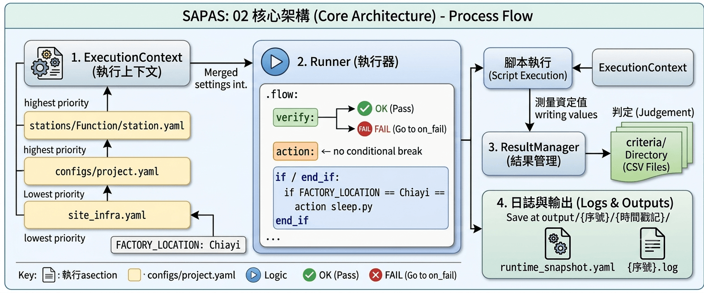

# 02 核心架構 (Architecture)

Sapas 的架構設計旨在分離「測試邏輯」、「環境設定」與「連線驅動」。我們以 `example/Alishan` 的 `Function` 站為例來說明。



## 1. ExecutionContext (執行上下文)

`ExecutionContext` 是整個系統的數據中樞，它會在啟動時自動合併設定檔。優先權如下：
`stations/Function/station.yaml` > `configs/project.yaml` > `site_infra.yaml`。

**範例**：
在 `site_infra.yaml` 中定義了 `FACTORY_LOCATION: Chiayi`。在 `function.flow` 中就可以直接使用這個變數進行判斷。

**變數存取介面**：
日後不論是在 **Python 腳本 (Script)** 中，若想要讀取或寫入數據，都可以透過 `sapas.var.get()` 與 `sapas.var.set()` 來達成。它相當於一個「全域變數級別」的儲存空間，確保數據能在不同步驟間流暢傳遞。

## 2. Runner (執行器)

`Runner` 負責解析 `.flow` 檔案。參考 `example/Alishan/flows/function.flow`：

```yaml
start function
    cycle 1
        verify get_os_name.py                                              # 執行腳本並驗證結果
        delay 3                                                            # 內建延遲功能
        if FACTORY_LOCATION == Chiayi
            action sleep.py --sec 2                                        # 條件判斷執行
        else
            action sleep.py --sec 1                                        # 條件不成立時執行
        end_if
        action demo_logs.py                                                # 執行日誌演示腳本
        prompt --show usb_disk.png --text "Insert USB"                     # 操作員提示
stop

on_fail
    action sleep.py --sec 4                                                # 失敗時的回退機制
end

final
    action power_off.py                                                    # 無論測試 PASS 或 FAIL 皆保證執行的收尾動作
end
```

### 流程區塊與關鍵指令：

#### 流程區塊：
- `start ... stop`: 主測試流程區塊。
- `on_fail ... end`: 失敗診斷與復歸區塊。當主流程中任何 `verify` 失敗時觸發。
- `final ... end`: 最終保證執行區塊（類似 Python 的 `try...finally`）。無論測試結果為 PASS 還是 FAIL，皆保證在測試週期末尾執行，適合放置關閉電源、設備復位或 Shopfloor 結果上傳等關鍵收尾動作（支援 `action`、`delay`、`prompt`、`if / else / end_if`，不允許使用 `verify`）。

#### 關鍵指令：
- `verify`: 失敗時會立即中斷並跳轉至 `on_fail`。
- `action`: 執行任務但不強制檢查結果。
- `delay`: 內建延遲功能，暫停執行指定秒數。
- `prompt`: 內建操作員提示對話框。支援彈出扁平暗色調視窗以顯示圖片 (`--show`) 與自訂文字說明 (`--text`)，按空白鍵/Enter即可快速確認。在無 GUI 環境下會自動降級為終端機輸入模式。
- `if / else / end_if`: 支援根據 `ExecutionContext` 中的變數進行分支判斷（支援 `if ... else ... end_if` 二元分支，最多支援 2 層巢狀結構；不支援 `elif` 以保持流程檔簡明）。

## 3. ResultManager (結果管理)

當腳本執行時，它會將測量值寫入系統。測試結束後，`ResultManager` 會根據 `criteria/` 目錄下的 CSV 檔案進行判定。

## 4. 日誌與獨立 HTML 診斷報表 (Logs & Standalone HTML Reports)

每次測試執行完畢後，所有產出皆會自動歸檔於 `output/{序號}/` 目錄下：

```text
output/
├── sapas_local_{STATION}_{FIXTURE_ID}.db       # 本機 SQLite 站點高速資料庫 (WAL 模式)
├── station_summary_{STATION}_{FIXTURE_ID}.html # 互動式全站良率與異常分析總表 (由 sapas summary 產出)
└── {SN}/
    ├── {SN}_{Timestamp}_{PASS|FAIL|STOP}.html  # 獨立單一檔案 HTML 診斷報表
    ├── {SN}.log                                # 該序號的完整終端執行日誌
    └── {Timestamp}/                            # 單次測試明細資料夾
        ├── runtime_snapshot.yaml               # 該次測試結束時的設定與變數快照
        └── {LOGS_FOLDER}/                      # 各 TestItem 產出的原始量測與 CSV 結果
```

### 📊 獨立 HTML 診斷報表 (`{SN}_{Timestamp}_{STATUS}.html`)
為了解決產線與 RD 之間「打包整包 Log 傳送繁瑣、翻找數百個細項費時」的痛點，Sapas 會在每次測試週期結束時自動生成一份 **100% 離線、零外部依賴（無需連網或 CDN）** 的單一 HTML 檔案：
- **一眼辨識的檔名與頂部大橫幅**：檔名直接包含 `{序號}_{時間戳記}_{PASS|FAIL|STOP}.html`，現場人員只需傳送這一個小檔案，工程師連點開前就能從檔名看出機器序號與最終判定結果。
- **治具編號 (`FIXTURE_ID`) 與重測次數 (`Retest`) 自動追蹤**：頂部與摘要卡片清楚標示站別、治具 ID、首次錯誤碼 (`First Error Code`)，並自動偵測該序號是第幾次測試（如 `Run #1`、`Run #2 (Retest)`）。
- **以 `.py` 腳本為單位的智慧摺疊表格 (`[+] script.py`)**：
  - **全 PASS 腳本預設收合 (`[+]`)**：即使整站有上百個細項，畫面依然清爽呈現各支 `.py` 的執行順序、通過率（如 `17 / 17 PASS`）與單支腳本執行秒數（`Time` 欄）。點擊即可展開查看子細項。
  - **含 FAIL 或 Crash 腳本自動展開 (`[−]`)**：只要某支 `.py` 內有任何細項失敗，或發生未預期腳本閃退 (`CRITICAL / EXCEPTION`)，開啟報表時該腳本會**自動展開並以紅底高亮標示**，第一時間鎖定問題根因。
- **內嵌原始終端日誌 (`Raw Console Log`)**：報表底部內建可展開的完整 Console Log，單一 HTML 檔案即同時具備「高階視覺化統計」與「底層除錯 Log」。

### 🗄️ 本機 SQLite 站點資料庫與互動式總覽儀表板 (`sapas summary`)
除了單機診斷報表外，Sapas 會在每次測試結束時，以 SQLite `WAL (Write-Ahead Logging)` 模式於 `< 2ms` 內將該次測試摘要與完整子測項快照寫入 `output/sapas_local_{STATION}_{FIXTURE_ID}.db`：
- **極速寫入、零欄位膨脹**：採用「固定核心索引欄位 + `measurements_json` 完整細項快照」架構，徹底避免傳統將數百個測項名稱動態新增為資料表欄位（`ALTER TABLE`）所造成的長期運作卡頓。
- **瀏覽器內建互動式篩選與良率重算**：執行 `sapas summary` 產出 `station_summary_{STATION}_{FIXTURE_ID}.html` 後，無需帶複雜 CLI 參數，直接在瀏覽器內點選日期區間（`Today`、`Yesterday`、`Last 7 Days`、`Last 30 Days`、自訂 `From ~ To`）、狀態篩選（`PASS` / `FAIL` / `STOP`）或關鍵字搜尋（`SN` / `ErrCode` / `.py`），畫面上的 **整體良率 (Yield %)**、**一次良率 (FPY %)**、**Top Failures 柏拉圖** 與 **產能趨勢圖** 皆會毫秒級即時聯動更新。
- **無懼 FTP 搬移的資料庫快照檢視 (`Database Snapshot Modal`)**：即使產線工位電腦已將舊的 `output/{SN}/` 測試資料夾搬移至 FTP/NAS 歸檔，或工程師僅拿到一顆 `.db` 檔案，在總表中點擊任一筆測試紀錄即可直接彈出該次測試的完整 `.py` 摺疊量測明細：

```bash
# 自動偵測 output/ 下的本機資料庫並開啟瀏覽器儀表板
sapas summary

# 直接指定任意路徑（如桌面或下載資料夾）的 .db 檔案產出並開啟儀表板
sapas summary ~/Desktop/sapas_local_FAN_44205100.db
```

